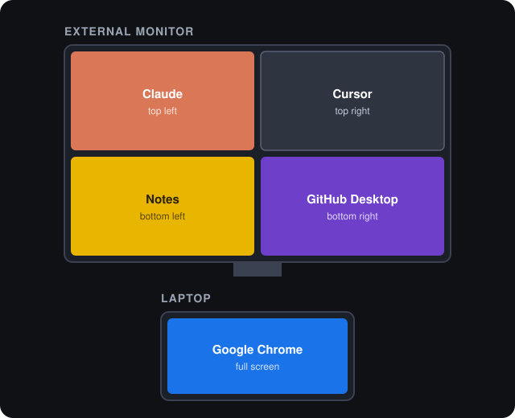
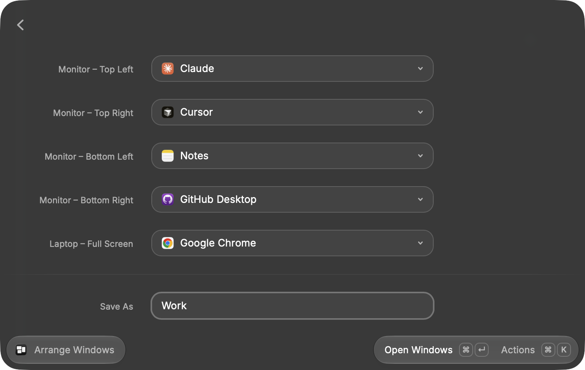
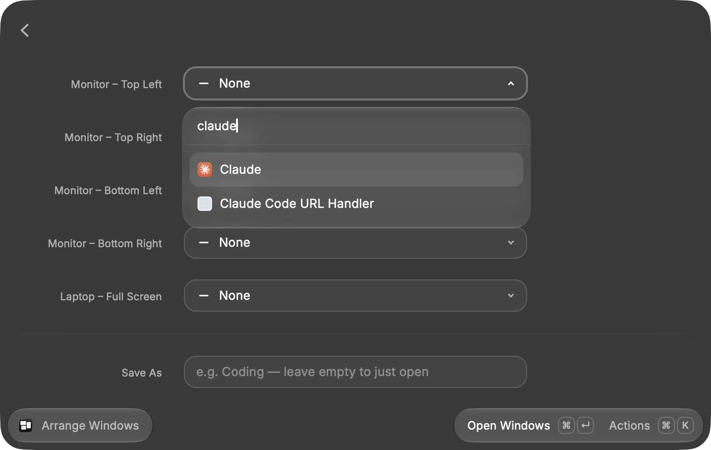
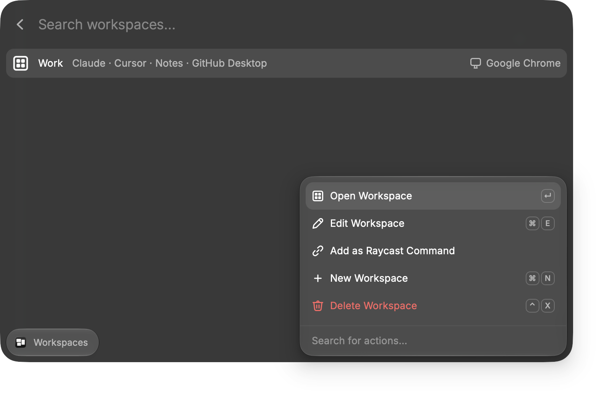

# Workspace Launcher for Raycast

Open five apps with one command: four on your external monitor, one in each quarter, and one full screen on your laptop. Save each set of apps as a workspace, such as "Work", and open it again by name.

<p align="center">
  
</p>

## Install

You need macOS, [Raycast](https://raycast.com) and [Node.js](https://nodejs.org) 22 or newer.

```bash
curl -fsSL https://raw.githubusercontent.com/salimabsi/raycast-workspace-launcher/main/install.sh | bash
```

This downloads the extension to `~/.raycast-extensions/workspace-launcher` and adds it to Raycast. Run the same command again to update.

<details>
<summary>Install manually</summary>

```bash
git clone https://github.com/salimabsi/raycast-workspace-launcher.git
cd raycast-workspace-launcher
npm install
npm run dev
```

When it prints `ready`, press <kbd>Ctrl</kbd>+<kbd>C</kbd>. The extension stays in Raycast.
</details>

The first time you open a workspace, macOS asks whether Raycast may control **System Events**. Allow it, because that's how windows get moved.

## Use

### Arrange Windows

Pick an app for each spot. Leave **Save As** empty to open the apps just this once, or type a name to save them as a workspace too.



Each picker lists your installed apps. Type to search.



| Key | Action |
|---|---|
| <kbd>⌘</kbd> <kbd>↵</kbd> | Open the windows (and save, if a name is given) |
| <kbd>⌥</kbd> <kbd>↵</kbd> | Save without opening |

### Workspaces

All saved workspaces. Press <kbd>↵</kbd> to open one.



| Key | Action |
|---|---|
| <kbd>↵</kbd> | Open the workspace |
| <kbd>⌘</kbd> <kbd>E</kbd> | Edit |
| <kbd>⌘</kbd> <kbd>N</kbd> | New workspace |
| <kbd>⌃</kbd> <kbd>X</kbd> | Delete |

**Add as Raycast Command** turns a workspace into its own entry in Raycast's main search. You can then give it a hotkey or alias in Raycast settings.

### Open Workspace

Type a workspace name, or the start of one, and press <kbd>↵</kbd>:

```
Open Workspace  work
```

## How it works

- **Finding the screens:** the laptop is the built-in display and the monitor is any other display. With no monitor connected, the four quarters go on the laptop screen.
- **Waiting for apps:** each app is opened and given up to 10 seconds to show a window before that window is moved and resized.
- **Same app twice:** if the same app is picked for two spots, the second spot gets a new window (<kbd>⌘</kbd> <kbd>N</kbd>).
- **Storage:** workspaces are saved in Raycast's local storage on your Mac.

## License

MIT
